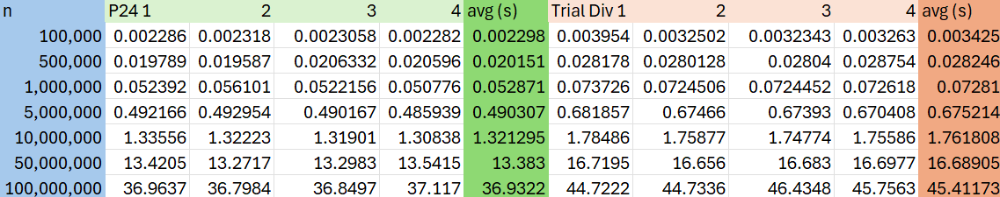
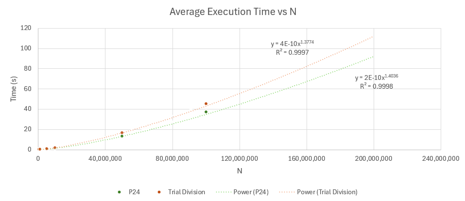

# Project P24

An experimental prime solving program designed to predict and list all prime numbers within n=5 to a range. 
(Designed in late 2021)

## Performance

    Timed with an i5-10400 Processor:
-n = 1,000,000: 0.052 seconds average

-n = 10,000,000: 1.32 seconds average

-n = 100,000,000: 36.9 seconds average

P24 was compared to an optimized trial division algorithm, in which odd numbers within the range of n were divided up to their respective square. The test conducted accounts for inputs between n=100,000 and 100,000,000. In summary, it was found that p24 __consistently outperforms trial division by about 25-40%__. 
However, Power law regression yields a higher exponent value in comparison. This means that Trial division is faster, but only after n=150,000,000,000 (150 billion). This scenario would take about __23 days__ of straight runtime to observe, if even allowed by C++. 

    Chart comparing the runtime of P24 and Trial Division:

    Graph comparing the runtime of P24 and Trial Division:

## How it works

Similar to algorithms like primesieve and 6k+/-1 methods, P24 does not directly search for prime numbers. Instead, it maintains and traverses through a list of non-candidates up to an index actively maintained by variable __max_i2__, which scales rapidly as the input size n grows. 
    
    Process:
Variable __base__ is initialized to 5. __basenext__ is 2. 
__base__ adds __basenext__, which alternates between 2 and 4: (5+2, 7+4, 11+2, 13+4,...)
The squared value of __base__ is also tracked. At __base__ = 5, 25 is stored. The next alternation, 7, adds 49.
When base equals 25, the algorithm finds that 25 was stored already. It will not add this value. Instead, it is removed and replaced. What this looks like: 25 is removed. 25+(original base value 5 * its respective basenext 2) = 35, and replaces 25. 5's respective basenext alternates to 4. When __base__ =35, 35+(5*4)=55 will replace 35. This also implies that the number 45 will not be considered, and 55 is guaranteed to be reached by alternation. 

